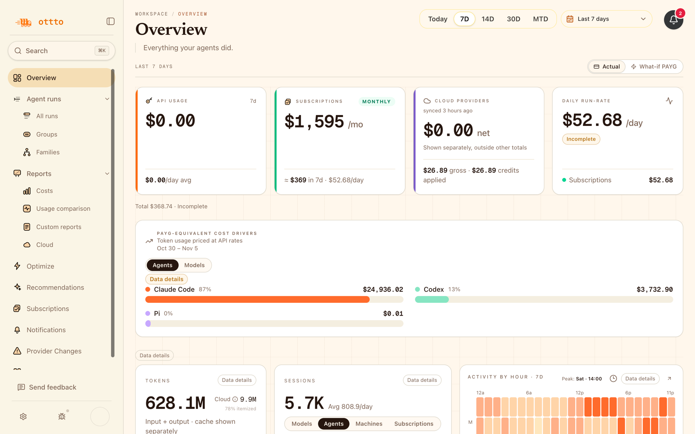
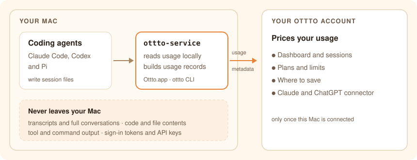

# Ottto

Ottto is one tool to see what is right and what is wrong with your coding agents. It works with
several coding agents on your Mac, such as Claude Code, Codex and Pi.

- **Everyday work:** usage, plan limits and cost across your agents, logins and Macs, at a glance.
- **What should you optimize:** where your cost goes and which setup problems may hold your agents
  back, based on your own sessions and setup, so you fix what matters first.

<p align="center">
  <picture>
    <source media="(prefers-color-scheme: dark)" srcset="docs/assets/readme/overview-dark.png">
    
  </picture><br>
  <sub>The Overview page of the Ottto dashboard, showing a demo account's data.</sub>
</p>

## Get started

1. **Install Ottto.app.**
   [**Download Ottto for Mac**](https://install.ottto.net/ottto-local-platform/releases/stable/latest/Ottto-macos-arm64.dmg)
   (Apple silicon, macOS 14 or later; signed and notarized).

   Prefer the command line? Homebrew installs the `ottto` CLI and the background service (not the
   app). Use one or the other:

   ```bash
   brew install ottto-ai/tap/ottto
   brew services start ottto
   ```

   More options, updates and uninstall: [docs/install.md](docs/install.md).

2. **Sign in to your Ottto account** in the app, or run `ottto setup`. This connects your Mac and
   unlocks everything below: the full dashboard, the findings, and Ottto for Claude and ChatGPT.

## With and without an account

**Ottto for Claude and ChatGPT:** ask about your usage, cost, data sources and recommendations from
the chat you already use. Ottto's connector is read-only and cannot change anything in your account.

| | Without an account | With an Ottto account |
| --- | :---: | :---: |
| Find the coding agents on your Mac | ✓ | ✓ |
| Check that Ottto's service is healthy | ✓ | ✓ |
| Collect diagnostics for support | ✓ | ✓ |
| Update and uninstall | ✓ | ✓ |
| Dashboard: usage, cost and sessions | | ✓ |
| Plans and limits for each login | | ✓ |
| Findings on cost and setup | | ✓ |
| Recommendations | | ✓ |
| Every Mac and login in one place | | ✓ |
| Ottto for Claude and ChatGPT | | ✓ |

## Everyday work

| | What you get |
| --- | --- |
| **Every agent in one view** | Claude Code, Codex and Pi, side by side · subscription or API key · Bedrock and Vertex AI billing (org admins) |
| **Plans and limits** | Several subscriptions and accounts: up to 10 Claude Code and 10 Codex logins per Mac · 5-hour and weekly windows |
| **Cost breakdowns** | By agent, model, repository, machine, subscription and token type · day, week or month · CSV export |
| **Sessions and sub-agents** | Timeline, tokens and models per run · which agent spawned which sub-agent, and what each one cost |
| **Many Macs, one account** | Every Mac you connect adds up in one account · logins stay separate |

<details>
<summary>More about everyday work</summary>

- **Agents** are counted from what they record on your Mac, whether they run on a subscription or
  an API key. Org admins can connect Bedrock and Vertex AI billing, read-only.
- **Limits** include per-model limits, credits and reset times where the provider shows them. They
  appear only when Ottto can match a reading to the right login. For automatic Codex limit
  updates, turn on **Keep limits up to date** on each Mac.
- **Cost** shows estimated actual cost next to the pay-as-you-go value of the same usage, so you
  can see what a plan is worth to you. Subscription fees are prorated; unknown payers and unpriced
  usage can make the estimate partial.
- **Sessions** show context measurements and compactions where the agent records them. The
  Families view gives each agent's own cost where priced, and a total for the family.
- **Logins** are never pooled or rotated to get around limits.

</details>

## What should you optimize

Sign in, and Ottto imports recent sessions from your Mac in the background, so findings start from
history you already have. It points you to the biggest costs and setup problems first; the fix is
yours to choose.

| | What you get |
| --- | --- |
| **Where to save** | Findings from your own sessions and setup, with evidence · a prompt you can paste into your agent |
| **Recommendations** | A Recommendations page with prioritized suggestions for your account |
| **Setup that holds agents back** | Nested AGENTS.md Claude Code does not load on its own · a CLAUDE.md too large to load · a MEMORY.md near its limit |
| **What fills the context window** | Instruction and memory files, skills and MCP tools at start · files read, search and tool output while working |
| **Setting changes and their cost** | Cost per request before and after you change the default model, reasoning effort or fast mode |
| **Repeated and scheduled runs** | What repeated work and automations cost |

<details>
<summary>More about what to optimize</summary>

- **Findings** include MCP tools whose definitions load up front in your latest setup, Claude Code
  sessions with very large contexts, the extra cost of Claude Code fast mode, and sessions on an
  older Claude Code version without idle compaction. Each finding is labeled, for example
  **Measured** or **Estimate**. Dollar figures on findings cover only the stated period, appear
  only when pricing is complete, and are not projected. The prompt asks your agent to investigate
  first and change nothing yet.
- **Context** start sizes are measured where the agent records them; what enters while working is
  estimated.
- **Setting changes** use the saved settings Ottto sees, not every temporary switch. They compare
  the same agent and Mac before and after; results say when the evidence is thin, and a
  before-and-after comparison is not proof of cause.
- **Repeated runs** are grouped by scheduled task, repeated prompt template or repeated title.

</details>

## How it works

<p align="center">
  <picture>
    <source media="(prefers-color-scheme: dark)" srcset="docs/assets/readme/how-it-works-dark.svg">
    
  </picture>
</p>

Ottto is not a proxy or an AI gateway. It does not reroute your agents' model requests and does
not change their API key or base URL. It reads the session files your agents already write.

## The `ottto` CLI

Use the app for the graphical interface. Use the CLI when you want to:

- script Ottto or read your data as JSON: every documented command takes `--json` and returns
  documented exit codes
- run Ottto on a Mac you reach over SSH
- let Claude Code or Codex check their own Ottto setup, with the [skills](docs/agent-adapters.md)

Install it with Homebrew, as in [Get started](#get-started). Ottto.app does not add `ottto` to
your PATH.

```bash
ottto setup                   # connect this Mac to your Ottto account, in your browser
ottto apps detect --json      # find supported agents on this Mac
ottto doctor                  # show current service and agent health
ottto fix --app claude-code   # repair Ottto's setup for an agent (or codex, pi)
ottto costs --json --days 7   # the last 7 days of cost across your account, as JSON
```

## Privacy

**Ottto never uploads your transcripts or full conversations.**

**What never leaves your Mac**

- Your transcripts and full conversations, including your agents' responses
- Code, file contents, and tool and command output
- Your agents' sign-in tokens, API keys, cookies and passwords
- Instruction, memory and skill text, and absolute file paths

To show your Claude plan limits, Ottto uses your Claude Code sign-in only to ask Anthropic for your
usage, and never sends it to Ottto. Turn this off in Ottto.app settings: **Read subscription usage**.

**What is sent, only once you connect this Mac to an Ottto account (setup)**

Usage metadata, so Ottto can price your usage and find savings: token counts, session timing and
activity counts, plan limit usage, metadata about your accounts and workspaces (such as login
emails, plans and ids), agent settings, one-way hashes of paths and of repeated prompts to group
sessions, and basic details about the Mac. Setup sends the Mac's basic details when it starts.
Diagnostics are a separate upload, sent only when you approve it.

Two settings in the web dashboard (app.ottto.net → **Settings → Data & privacy**) add more:

- **Readable labels** (on by default; a workspace admin can turn it off for everyone). With it on,
  Ottto also sends each session's title, or the first 80 characters of its first prompt when the
  session has no title, and, for prompts you repeat, a short start of that prompt (96 bytes at
  most, with paths removed), so you can recognize sessions. It also sends project
  folder and repository names, the names of skills, custom agents, MCP servers and MCP tools, and
  the repository paths of files in a session's context. Turning it off stops those. Built-in tool
  names, counts and account metadata are still sent.
- **Session links** (off by default; a workspace admin setting). With it on, Ottto also sends pull
  request, issue and commit links found in a session. They name their repository even with
  Readable labels off.

If you add Ottto to Claude or ChatGPT, the answers you ask for go into that chat.

More: [privacy policy](https://app.ottto.net/privacy) for the hosted service and
[docs/privacy.md](docs/privacy.md) for this runtime.

## Open source

This repository holds Ottto's local runtime, written in Rust: the `ottto` CLI, the `ottto-service`
background service, the connector SDK and the readers for Claude Code, Codex and Pi. Ottto.app and
the hosted dashboard are not in this repository. Build and test: [CONTRIBUTING.md](CONTRIBUTING.md).
To add an agent, start with [connectors/README.md](connectors/README.md).

[Docs](docs/README.md) · [Install](docs/install.md) · [Troubleshooting](docs/troubleshooting.md) ·
[Contributing](CONTRIBUTING.md) · [Security](SECURITY.md) · [Code of conduct](CODE_OF_CONDUCT.md) ·
Apache-2.0 [license](LICENSE)

<p align="center"><sub><i>Three t's: one for every agent you forgot was still running.</i></sub></p>
