# Ottto

Ottto is one tool to see what is right and what is wrong with your coding agents. It works with
several coding agents on your Mac, such as Claude Code, Codex and Pi.

- **Everyday work:** usage, plan limits and cost across your agents, logins and Macs, at a glance.
- **What should you optimize:** where your cost goes and which setup problems may hold your agents
  back, based on your own sessions and setup, so you fix what matters first.

<!-- Product visual: coming soon -->

## What Ottto does on your Mac

- **Reads** the session files that Claude Code, Codex and Pi write (`~/.claude/projects`,
  `~/.codex/sessions`, `~/.pi/agent/sessions`) and a few named settings from their config.
- **Uploads nothing about your usage until you connect** this Mac to an Ottto account. Then it
  sends usage metadata, never your transcripts, code, tool output or sign-in tokens
  ([what is sent](#privacy)).
- **Sends session titles, repository names and MCP tool details by default.** Every 6 hours it
  starts your local stdio MCP servers for Claude Code and Codex to list their tools, and sends each
  tool's name, description and input schema. In the web dashboard, **Readable labels** turns all
  of these off, and **MCP inventory harvesting** only the MCP part.
- **Reads your plan limits** from Anthropic with Claude Code's sign-in, and through the Codex CLI
  for Codex. Each can be turned off.
- **Runs short `claude`, `codex` and `pi` commands** to check your setup (including test prompts),
  read limits and keep Claude sign-ins fresh.
- **Edits agent settings** on setup and repair: Claude Code's `~/.claude/settings.json` (telemetry
  and status line) and a marked line in `~/.zshrc`. Later checks put its status line back. At
  start it removes only its own old entries from `~/.codex/config.toml`.
- **Receives Claude Code's telemetry** on 127.0.0.1 and keeps content-free per-request rows (ids,
  model, effort, speed, reported cost and token counts), which feed the usage it uploads.

The Mac app is a client of this daemon: it doesn't read transcripts or agent credentials and
uploads no usage itself. Details: [docs/privacy.md](docs/privacy.md).

## Get started

1. [**Download Ottto for Mac**](https://install.ottto.net/ottto-local-platform/releases/stable/latest/Ottto-macos-arm64.dmg)
   (Apple silicon, macOS 14 or later; signed and notarized). Or install the `ottto` CLI and
   background service, without the app, with Homebrew:
   `brew install ottto-ai/tap/ottto && brew services start ottto`. Use one or the other. More
   options, updates and uninstall: [docs/install.md](docs/install.md).
2. **Sign in to your Ottto account** in the app, or run `ottto setup`. This connects your Mac.

Without an account, Ottto finds the agents on your Mac, checks its own service, collects
diagnostics, and updates or uninstalls. An account adds the dashboard, plans and limits for each
login, findings, recommendations, every Mac in one place, and **Ottto for Claude and ChatGPT**: a
read-only connector to ask about your usage, cost and recommendations from the chat you use.

## Everyday work

Cost is an estimate: subscription fees are prorated, and unknown payers or unpriced usage can make
it partial. Limits appear only when Ottto can match a reading to the right login.

| | What you get |
| --- | --- |
| **Every agent in one view** | Claude Code, Codex and Pi, side by side · subscription or API key · Bedrock and Vertex AI billing (org admins) |
| **Plans and limits** | Several subscriptions and accounts: up to 10 Claude Code and 10 Codex logins per Mac · 5-hour and weekly windows |
| **Cost breakdowns** | By agent, model, repository, machine, subscription and token type · day, week or month · CSV export |
| **Sessions and sub-agents** | Timeline, tokens and models per run · which agent spawned which sub-agent, and what each one cost |
| **Many Macs, one account** | Every Mac you connect adds up in one account · logins stay separate, never pooled or rotated |

## What should you optimize

After you sign in, Ottto imports recent sessions in the background, so findings start from history
you already have. It points you to the biggest costs and setup problems first; the fix is yours.
Each finding is labeled, for example **Measured** or **Estimate**, and dollar figures appear only
when pricing is complete. A before-and-after comparison is not proof of cause.

| | What you get |
| --- | --- |
| **Where to save** | Findings from your own sessions and setup, with evidence · a prompt you can paste into your agent |
| **Recommendations** | A Recommendations page with prioritized suggestions for your account |
| **Setup that holds agents back** | Nested AGENTS.md Claude Code does not load on its own · a CLAUDE.md too large to load · a MEMORY.md near its limit |
| **What fills the context window** | Instruction and memory files, skills and MCP tools at start · files read, search and tool output while working |
| **Setting changes and their cost** | Cost per request before and after you change the default model, reasoning effort or fast mode |
| **Repeated and scheduled runs** | What repeated work and automations cost |

## How it works

  <picture>
    <source media="(prefers-color-scheme: dark)" srcset="docs/assets/readme/how-it-works-dark.svg">
    
  </picture>

Ottto is not a proxy or an AI gateway: it does not reroute model requests or change API keys or
base URLs. The `ottto` CLI scripts Ottto (`--json`, documented exit codes), runs over SSH, and lets
agents check their own setup with the [skills](docs/agent-adapters.md). The app doesn't add it to PATH.

## Privacy

**What Ottto never uploads:** your transcripts and full conversations, including your agents'
responses; code, file contents, and tool and command output; your agents' sign-in tokens, API keys,
cookies and passwords; instruction, memory and skill text, and absolute file paths (except text an
MCP server itself puts in a tool description or input schema).

**What is sent, only once you connect this Mac:** usage metadata, so Ottto can price your usage:
token counts, session timing and activity counts, plan limit usage, account and workspace metadata
(such as login emails, plans and ids), agent settings, one-way hashes of paths and repeated prompts,
and basic details about the Mac. Diagnostics are a separate upload, sent only when you approve it.

**Readable labels** (on by default) also sends session titles or a short prompt start, project and
repository names, skill, agent and MCP names, and MCP tool details; turning it off stops all of
those. **Session links** (off by default) sends pull request, issue and commit links. Your Claude
Code sign-in is used only with Anthropic, to read your usage and its account, and never sent to Ottto.
Full detail: [docs/privacy.md](docs/privacy.md) and the [privacy policy](https://app.ottto.net/privacy).

## Open source

This repository holds Ottto's local runtime in Rust: the `ottto` CLI, the `ottto-service` service,
the connector SDK and the agent readers. Ottto.app and the hosted dashboard are not here. Build and
test: [CONTRIBUTING.md](CONTRIBUTING.md). Add an agent: [connectors/README.md](connectors/README.md).

[Docs](docs/README.md) · [Install](docs/install.md) · [Troubleshooting](docs/troubleshooting.md) ·
[Contributing](CONTRIBUTING.md) · [Security](SECURITY.md) · [Code of conduct](CODE_OF_CONDUCT.md) ·
Apache-2.0 [license](LICENSE)

<i>Three t's: one for every agent you forgot was still running.</i>

